# OASA Bus Accuracy

How accurate are Athens bus (OASA) ETA predictions, and what kind of model is behind them?

I built a collector that polls OASA's live ETA feed every 45 seconds and saves every prediction to a database. It has been running since 27 July 2026 on my home server and has collected 744k polls. A Python script then reads the database, works out when each bus actually arrived, and compares that to every prediction made about it.

Node.js collector -> MySQL -> pandas/matplotlib. Both run in Docker. You point it at any OASA routes and stops by editing `routes.json`.

## What I Found

Error here is the difference between the predicted arrival and the actual one. Positive means the bus came later than the app said (you wait). Negative means it came earlier (you might have missed it).

**1. What matters most is how far ahead the prediction is made.** A 5 minute estimate is within a minute about two thirds of the time. A 45 minute estimate manages that less than one time in five.

**2. The error changes direction.** Short predictions run late, so the bus takes longer than promised. Long predictions run early, so it shows up before you expect it. That matters because the two cost you different things: a late bus costs you a wait, an early one costs you the bus.

**3. The stop and the hour of day do not really matter.** Both look like they do at first, but once you compare predictions made from the same distance out, the differences disappear.

**4. It seems the model does take hour/traffic congestion into account.** OASA expects the same stretch of road to take longer in some hours compared to others.

## The Questions

Two questions started this off, both from real life experience with the system :

1. How accurate are OASA's ETA predictions really?
2. What kind of model makes them? Just distance, or something that knows about traffic?

## Route and Stop Selection

I picked the 040 (Athens - Piraeus) route for a few reasons:

1. It is a long route, and a long route usually means different road types along the way, which means more data!
2. It goes straight through the centre of Athens, so it gets hit by traffic.
3. It runs day and night, so I get all 24 hours covered.

The ETA API is public and rate limited, so I can't poll all 38 stops every cycle. I had to compromise. Initially, I sampled 7 stops for each route, however, route 040 was running on a special roadwork version different from the normal at the start of collection, after the return to the normal route (at the 11th of August) a total of four (three from Piraeus -> Syntagma and one from Syntagma -> Piraeus) stops were not used anymore. As a result I continued to sample the remaining 6 stops in the Syntagma -> Piraeus direction and the 4 in the Piraeus -> Syntagma.

Since rows were tagged with the collector configuration that produced them, I was able to distinguish data from before (collector version 2) and after the change (collector version 3).

Data from all versions was only used in the accuracy distributions charts, all other charts used data collected from version 2 and 1 since they are stop dependent. The script as published however uses everything.

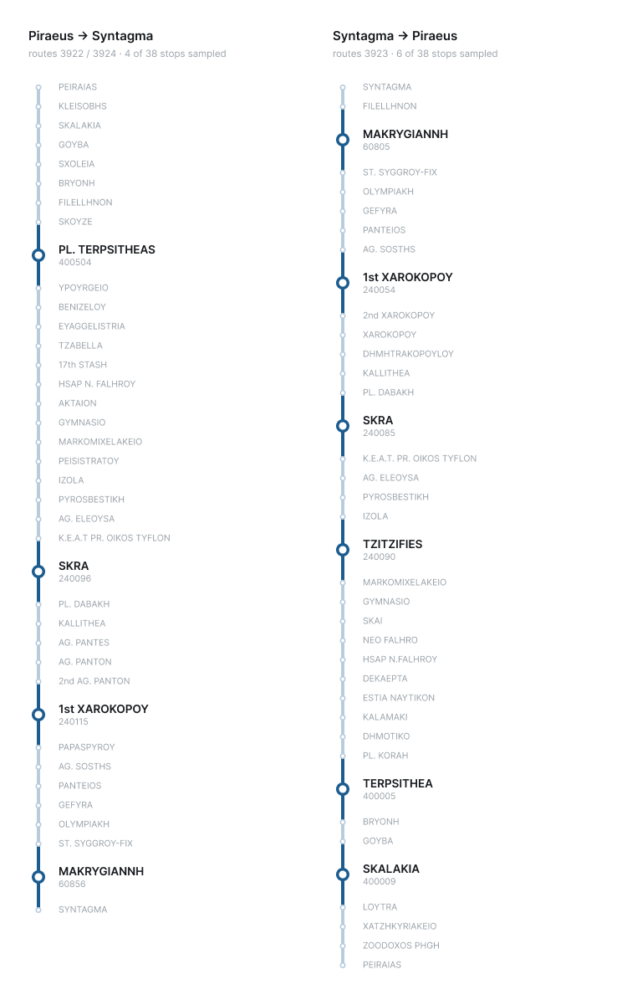

One thing worth knowing: the two directions use completely different stop codes for the same physical place. SKRA is `240085` going one way and `240096` going the other. So per stop results can't be compared between directions.

## Building the Dataset

The collector polls OASA's ETA endpoint about each stop I configured and writes every answer to MySQL. Each row holds:

| field | what it is |
|---|---|
| `route_code` | which route (3922 / 3923 / 3924) |
| `veh_code` | which actual bus |
| `stop_code` | which stop |
| `eta_minutes` | minutes until arrival, as the API reports it |
| `fetched_at_utc` | when the prediction was made |
| `active` | field to mark poll inactive (for a discontinued stop for example) |
| `collector_version` | field to mark data collected with different collector versions |

I started polling every 30 seconds. Then I compared consecutive polls and found the backend only updates every 60 seconds, so half of what I was saving was just a copy of the row before it. I moved to 45 seconds, which cuts the duplicates without ever being slow enough to miss an update.

The collector and the analysis are two separate services on purpose. The collector runs all the time and must not break. The analysis I re-run whenever I want, on whatever data has been collected.

## Analysis Methodology

The API only tells you what it predicts. It never tells you what actually happened. So I have to rebuild the ground truth myself.

### Episodes

I group all polls into **episodes**. An episode is one specific bus approaching one specific stop, followed across many polls. If the same bus passes the same stop again later in the day, that is a new episode.

To build them I sort all polls by time and group them by route, vehicle and stop. Then two thresholds decide where one episode ends and the next one starts:

- **Gap (max 20 min)**: how long since that bus was last listed at that stop.
- **Jump (max 3 min)**: how much the predicted time went *up* since the last poll.

A new episode starts if either threshold is passed, or if a bus/stop pair shows up for the first time.

Gap catches the easy case, where the bus disappeared from the feed for a while so whatever comes next is a new approach. Jump catches the harder one. A real approach counts down, so if the estimate suddenly climbs, that is not the same bus getting closer, it is the same bus starting a fresh pass (I still have to leave a generous margin for an actual ETA jump between two polls).

### Working out the arrival

Inside each episode I take the actual arrival from the **last** poll at the episode's lowest ETA.

The feed says "0 minutes" for a stretch of time, both while the bus is arriving and while it sits at the stop. The first of those polls fires while the bus is still coming, so using it puts every arrival about half a minute too early. The last one is closer to the truth.

### Filters

- Episodes where the lowest ETA never gets down to 2 or below are thrown away.
- Predictions under 3 minutes are excluded, since at that point the prediction and the arrival are basically the same moment.

## Results

Collection started on 27 July 2026. **Everything here is Late July / August data**, which is the emptiest month of the year in Athens. There is much less traffic than normal, so the model is under a lot less stress than it would be in winter. Treat these numbers as close to a best case.

### How is the error spread out?

Most predictions land close. The distribution has a sharp peak at zero and drops off fast on both sides.

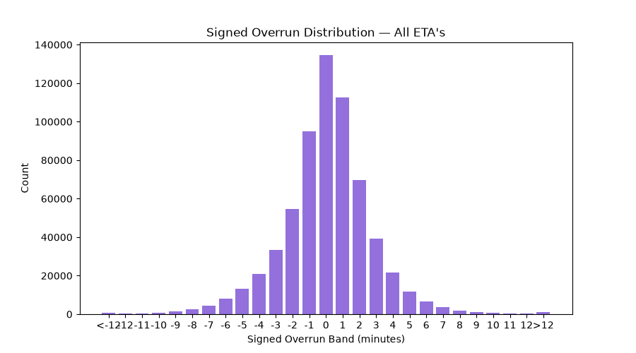

Splitting by how far ahead the prediction was made shows where the error actually comes from. At 3–7 minutes it is narrow and leans late:

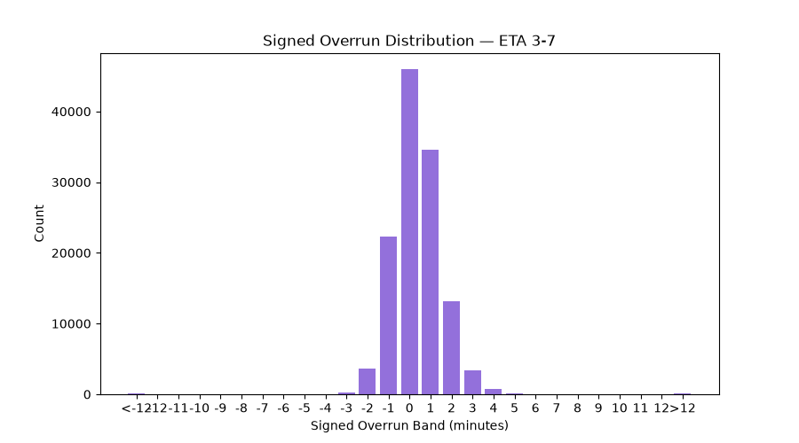

At 41+ minutes it is much wider, and the peak has moved to the *left* of zero, so long predictions run early:

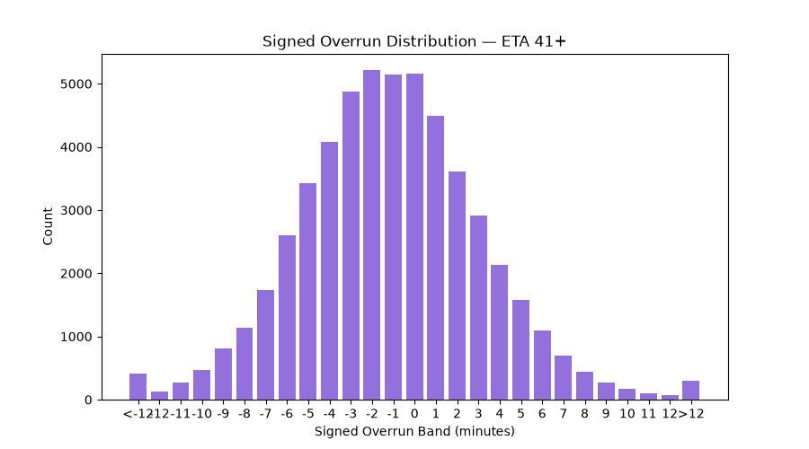

The bands in between sit somewhere between these two and shift gradually from one shape to the other.

### Does the stop matter?

At first it looks like it matters a lot. Some stops look twice as good as others, following are the stop charts with stops in actual route order (left are early stops, right are last stops).

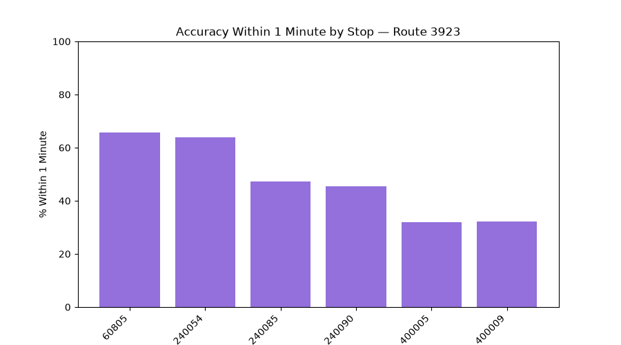

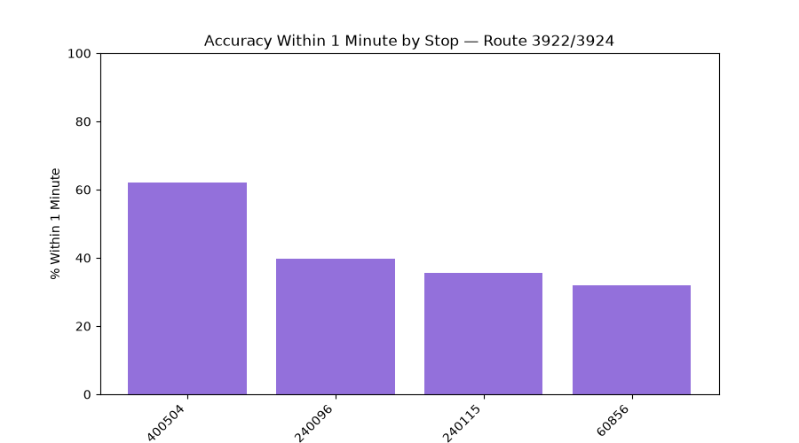

But that is not a real difference. Stops near the end of a route collect a lot of predictions made from 40+ minutes out, and those are much less accurate. Stops near the start only ever get predicted from a few minutes away. So what that number is really measuring is **position along the route**, not the stop itself.

If I only compare 3–7 minute predictions, which is the one band every stop has, the accuracy between stops becomes more stable :

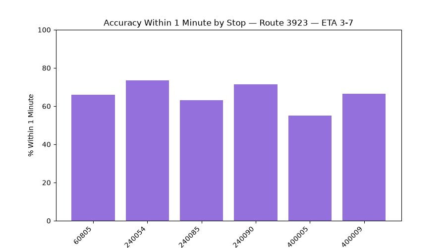

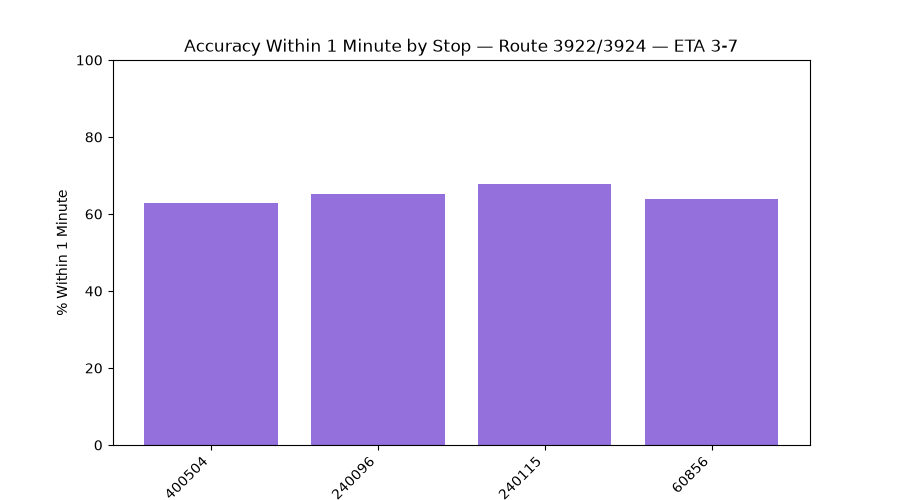


### Does the hour matter?

Accuracy barely moves by hour of day. Before controlling for anything, it sits within a few points of 40% across all 24 hours:

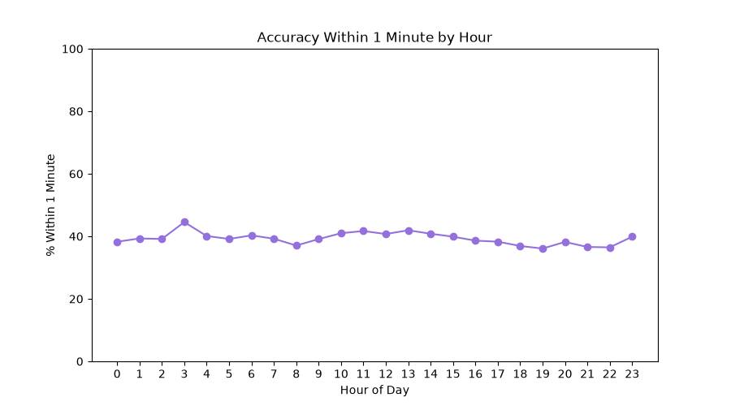

Restricting to 3–7 minute predictions lifts the whole line to around 65%, but leaves it just as flat:

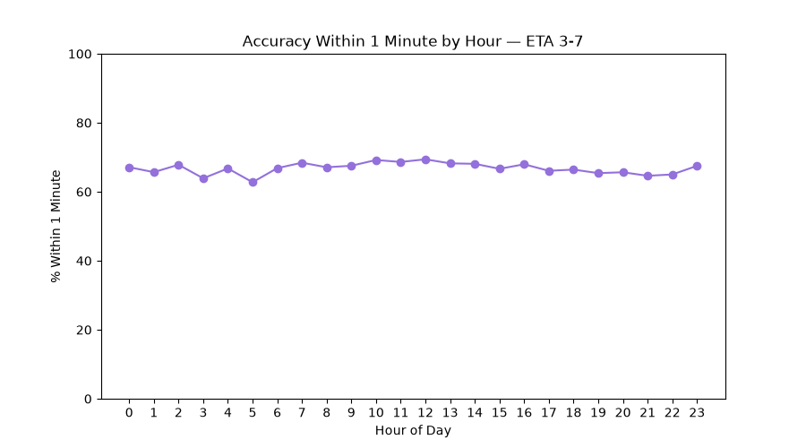

Hour of day isn't what determines accuracy, how far ahead the prediction was made is.

There is also a better reason for it being flat than "traffic doesn't affect buses", and it comes from the next section. **The model already adjusts for the time of day**, so accuracy stays level even though the roads don't.

### What model is OASA using?

You can actually get a good guess about this without any access to their system.

In one polling round, a single bus gets an ETA for several stops at once. So if a bus is 16 minutes from SKRA and 20 minutes from TZITZIFIES, the model thinks the stretch of road between the two stops takes 4 minutes. If I watch that number across the day, I can observe what the model believes about the road itself.

Comparing only polls made from a similar distance away, so the horizon stays constant:

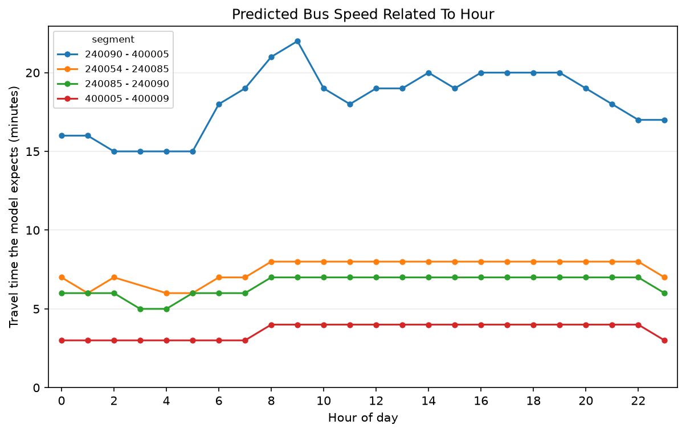

The longest segment (240090 → 400005) sits at 15 minutes overnight and 22 minutes at 9am. And there is an evening plateau too. **So the model definitely knows about the time of day.** A pure distance model could not do that.

The three shorter segments look flat, but that is just resolution. The API only gives whole minutes, so a 15% slowdown on a 7 minute road rounds to a single step. All three of them step up at 08:00 and back down at 22:00, at the same time as the long one, so they are clearly reading off the same profile.

**So my conclusion is that OASA's ETA most probably incorporates traffic congestion data into its model, either by the use of a built hourly matrix or by the use of live traffic data.**

## Limitations

- **The month.** This is all August data, when Athens is empty. The traffic the model is built to handle is mostly not there.

- **The arrival is inferred, not observed.** I rebuild it from the feed's own countdown, so if OASA is systematically off in how it reports the last minute, that goes straight into all of my numbers.

- **The alignment.** Part of this is the roadwork diversion rather than the 040's normal route. Stop-dependent results use the diversion only; the accuracy distributions pool both. The model findings are properties of the prediction system, so they should carry over.

## Future

I will keep the collector running into the winter. The August data is useful as a baseline. Once traffic comes back, the same pipeline on the same stops tells me whether accuracy drops everywhere or only in certain places and hours, and whether a genuinely bad traffic day moves the model's expectations at all.

## Running It Yourself

```bash
# collector (let this run for a few days)
cd oasa-accuracy-collector
cp .env.example .env #fill out the env
docker compose up -d --build

cd ..

# analysis (run this once you have enough data)
cd oasa-accuracy-analysis
cp .env.example .env #fill out the env
docker compose run --rm --build analysis
```

Edit `routes.json` to change which routes and stops get polled:

```json
{
  "routes":{
    "3923": ["60805", "240054", "240085", "240090", "400005", "400009"]
  }
}
```

Stops have to be listed in **travel order**. Several of the charts plot results along the route, and a reversed list will silently reverse them.

Charts get written to `oasa-accuracy-analysis/output/`.
